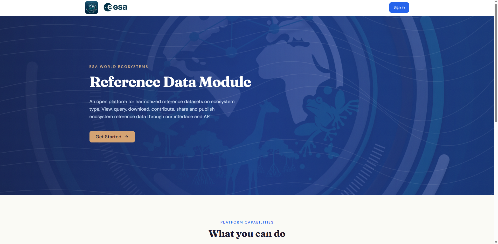
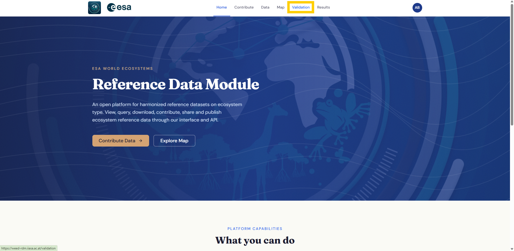
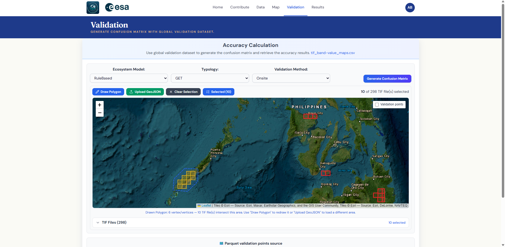
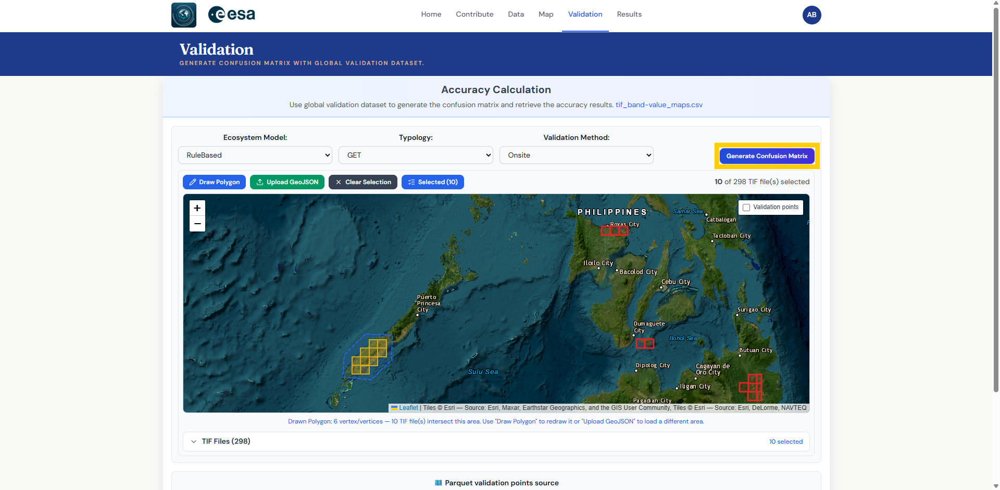
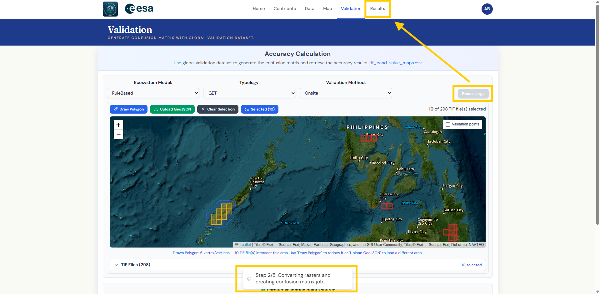
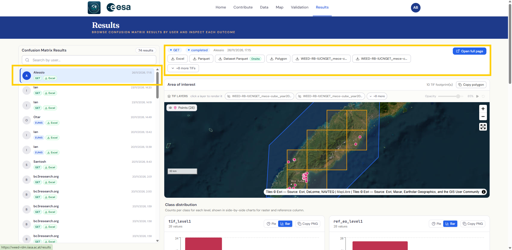
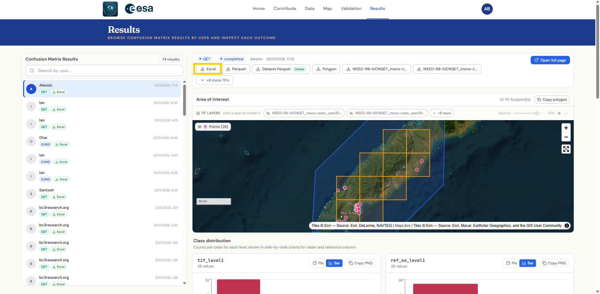
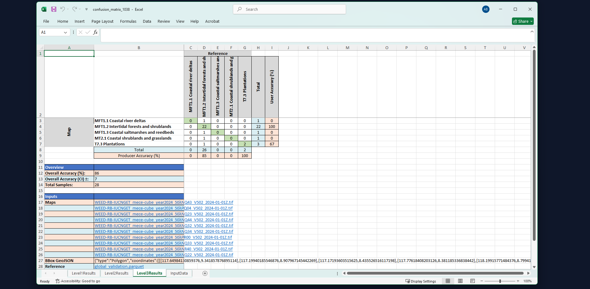
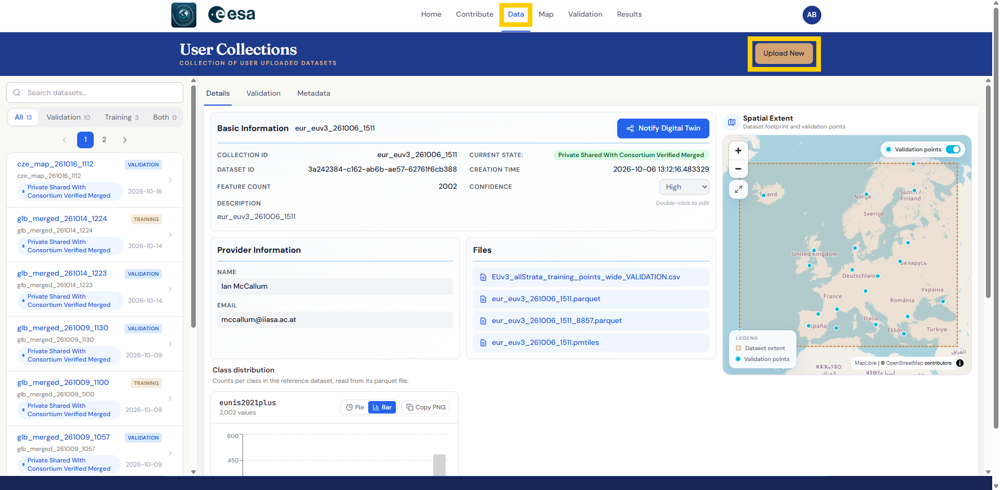

# WEED Champion User Guide: Assessing ecosystem map quality

This guide explains how Champion Users can assess ecosystem maps produced by WEED (World Ecosystem Extent Dynamics) and help improve both the maps and the reference data used to evaluate them.

The assessment combines your knowledge of the ecosystems in the area of interest with the maps, input data and validation results available through WEED. You do not need to be a GIS or statistics specialist to contribute useful feedback.

> **Draft for review:** The sections marked **To be confirmed** require additional information from the WEED team before this guide is published. They are not instructions to follow yet.

## 1. Overview of the assessment process

Map quality can vary across geographical areas and ecosystem types. Reference data, primarily points with an associated ecosystem label, can also vary in quality, spatial coverage, date and reliability. Champion Users can help identify where the maps or reference data should be improved.

Two complementary tools are currently available:

| Tool | What you can do |
| --- | --- |
| **[WEED application](https://weed.integratedmodelling.org/modeler/#/login?app=esa.aries.en)** | Obtain and visualise ecosystem maps, inspect model input data and documentation, and download data at their original resolution. Use this application to request map computations for areas that have not yet been calculated. |
| **[WEED Reference Data Module (RDM)](https://weed-rdm.iiasa.ac.at/)** | Generate quantitative validation results for available maps and review, contribute and manage reference data. |

The project aims to bring these capabilities together by the end of the project. For now, use the following workflow:

1. **Start in the WEED application.** Select your area of interest, obtain the ecosystem map and visually assess the results. Where useful, explore the input data and investigate possible reference data issues.
2. **Investigate in more detail.** Download the original-resolution data if you need to work in a GIS and/or use the RDM to generate a confusion matrix and review the reference points.
3. **Provide feedback.** Document suspected mapping errors, check and improve reference data where appropriate, and communicate unresolved issues to the WEED team.

Visual and quantitative assessment complement each other. A map can agree with most of the available reference points and still contain important errors elsewhere. Similarly, a disagreement with a reference point is not necessarily a mapping error: the reference label may be incorrect, outdated or uncertain.

## 2. Access the WEED application and visually assess the maps

### 2.1 Access the application and select an area of interest

Open the WEED application and identify the geographical area you want to assess. If you need to prepare a boundary or draw a context in k.Explorer, refer to the companion guide on preparing and sharing geographic boundaries.

**To be confirmed:** application URL, sign-in procedure, how Champion Users select a predefined or custom area, and the filename/link to the companion boundary guide.

### 2.2 Obtain the ecosystem map

Obtain the ecosystem map for the selected area and record the map year, model approach (RuleBased or Machine Learning), ecosystem typology and hierarchical level you are assessing. These details will help you identify the corresponding maps in the RDM later.

> **Important:** To trigger the computation of a map for an area that has not yet been calculated, use the WEED application first.

**To be confirmed:** exact steps and observation names for requesting each ecosystem product; how to select the year, model and typology; how to know that computation is complete and the map is available for RDM validation.

### 2.3 Perform a visual assessment

Use your knowledge of the area to identify locations where the mapped ecosystem types or their spatial distribution appear inconsistent with local conditions. Review both the overall pattern and individual locations.

The following questions can help guide your assessment:

| Aspect | Questions to consider |
| --- | --- |
| Ecosystem identification | Do mapped ecosystem types correspond to the ecosystems known to occur in the area? Are any expected ecosystem types missing? |
| Spatial distribution | Are ecosystem types mapped in plausible locations and spatial patterns? Are important patches or transitions missing? |
| Delineation | Do boundaries appear consistent with known ecosystem boundaries? Are there unexpected blocky, rectangular or fragmented patterns? |
| Ecological consistency | Are mapped classes consistent with the known environmental conditions, such as topography, climate, hydrology or vegetation? |
| Human-modified ecosystems | Where relevant, are natural and human-modified ecosystems distinguished in a plausible way? |
| Local detail | Are important small or narrow ecosystems represented? Consider the map's spatial resolution before interpreting an apparent omission. |

These are prompts for investigation, not formal acceptance criteria. Natural ecosystems do not always have smooth boundaries, and sharp or blocky boundaries can sometimes be real. Coarse-resolution input data can also introduce artificial patterns into higher-resolution outputs. Do not attribute an error to a particular input or model until you have investigated it.

When you identify a potential issue, record the location, mapped class, expected class (if known), the reason for your concern and a screenshot or other supporting evidence.

### 2.4 Explore the input data and model documentation

The WEED application also provides access to the underlying input data and model documentation. Use these to investigate whether an unexpected map pattern could be related to the inputs, the classification logic or the spatial and temporal characteristics of the data.

For example, if the map displays rectangular ecosystem patches where you expect an irregular transition, compare the pattern with relevant input layers. A similar pattern in an input layer may help identify the origin of the issue, although this alone does not prove causation.

**To be confirmed:** exact interface steps for displaying input layers, inspecting their values and opening the model documentation.

### 2.5 Consider the quality of the reference data

If a reference point appears inconsistent with the mapped ecosystem or with your local knowledge, identify it for further investigation. Consider whether the point is located correctly, whether its ecosystem label is plausible and whether the reference date is appropriate for the map year. A point near a boundary or in a mixed landscape may warrant additional caution.

At this stage, the aim is to identify points that deserve review, not to modify them to match the map. The RDM workflow in Section 3 explains how to investigate the reference data and prepare corrections.

**To be confirmed:** whether and how reference points can currently be displayed and inspected directly in the WEED application. If they are not available there, perform this part of the assessment in the RDM.

## 3. Detailed assessment: download the data and/or use the RDM

Depending on the issues identified in Section 2, you can download the data for independent analysis, use the RDM to obtain quantitative results, or do both. These are complementary options; downloading the maps is not a prerequisite for using the RDM.

### 3.1 Download data at their original resolution (optional)

The WEED application allows you to download data at their original resolution. This is useful when you want to examine map values in more detail or compare the maps with your own spatial datasets using a GIS such as QGIS.

When making comparisons, check the coordinate reference system, map year, spatial resolution, geographic extent and ecosystem typology. Make sure that class codes are interpreted using the corresponding legend or classification mapping. Differences in these characteristics can explain some apparent disagreements.

**To be confirmed:** exact download procedure, available formats, how the class legend or encoding is provided, and which output and input layers can be downloaded.

### 3.2 Access the Reference Data Module (RDM)

1. Open [https://weed-rdm.iiasa.ac.at/](https://weed-rdm.iiasa.ac.at/).

   

     
   

   

     <em>Figure 1. RDM home page.</em>
   

2. Select **Sign in** and authenticate with your Copernicus Data Space Ecosystem (CDSE) credentials.
3. Open the **Validation** tab.

   

     
   

   

     <em>Figure 2. Open the Validation tab.</em>
   

### 3.3 Configure the validation analysis

The **Validation** tab allows you to generate a confusion matrix using the available validation dataset and selected ecosystem maps.

1. Define the geographic area to analyse using **Draw Polygon** or **Upload GeoJSON**. Use an area consistent with the one assessed in the WEED application.
2. Select the appropriate settings:

   | Setting | Available choices / guidance |
   | --- | --- |
   | **Ecosystem Model** | `RuleBased` or `Machine Learning`. Select the model corresponding to the map you wish to evaluate. |
   | **Typology** | `GET` (IUCN Global Ecosystem Typology; use outside the EU) or `EUNIS` (EU only). Match the map typology. |
   | **Validation Method** | `Onsite` or `Offsite`. **To be confirmed:** definitions and guidance for choosing between the two methods. |

3. Check the selected map footprints and the number of TIF files selected. The screenshot below shows an example in which ten TIF files are selected. Verify that the selected maps correspond to the intended assessment.

  

  <em>Figure 3. Define the validation area and settings.</em>

**To be confirmed:** whether GET is also selectable within the EU, how to choose a map year/version, what validation method to select, and whether the analysis is clipped to the drawn polygon or includes all samples within the selected TIF footprints.

### 3.4 Generate and retrieve the validation results

1. Select **Generate Confusion Matrix** to trigger the accuracy calculation.

   

     
   

   

     <em>Figure 4. Generate the confusion matrix.</em>
   

2. When the calculation has been triggered, navigate to the **Results** tab. Wait until the relevant result is completed.

   

     
   

   

     <em>Figure 5. Accuracy calculation in progress and Results tab.</em>
   

3. Select your result from the list. Check the area of interest, map files and available reference points. The example Results interface also shows class distributions and links to the output files.

   

     
   

   

     <em>Figure 6. Inspect the completed validation result.</em>
   

4. Select **Excel** to download the confusion matrix workbook.

   

     
   

   

     <em>Figure 7. Download the Excel confusion matrix.</em>
   

### 3.5 Understand the Excel workbook

The example Excel export contains four worksheets:

| Worksheet | Contents |
| --- | --- |
| `Level1Results` | Confusion matrix and accuracy results at the broadest classification level. |
| `Level2Results` | Results at the second classification level. |
| `Level3Results` | Results at the more detailed third classification level. |
| `InputData` | Individual records used in the assessment, including point identifiers, coordinates, reference timestamps, mapped ecosystem labels and reference labels. |

The results worksheets also contain an **Overview** of accuracy and sample count and an **Inputs** section listing the map files, geographic area (GeoJSON), reference dataset and typology mappings used for that result. Check these before interpreting the accuracy figures.

  

  <em>Figure 8. Example Level 3 confusion matrix in Excel.</em>

#### How to read a confusion matrix

A confusion matrix compares the ecosystem type assigned by the map with the ecosystem type recorded in the reference data at sampled locations.

In the RDM example workbook:

- **Rows (Map):** the ecosystem type predicted by the map.
- **Columns (Reference):** the ecosystem type recorded in the reference data.
- **Diagonal cells:** the number of samples where map and reference agree.
- **Off-diagonal cells:** the number of samples where map and reference disagree.
- **Row totals:** the number of samples mapped as each class.
- **Column totals:** the number of reference samples for each class.

Read an off-diagonal cell by combining its row and column labels. For example, a value of 1 in the `T7.3 Plantations` row and the `MFT1.2 Intertidal forests and shrublands` column means that one reference sample labelled MFT1.2 was mapped as T7.3. It does not establish which label is correct.

#### Understand the accuracy indicators

| Indicator | Calculation for the count-based example | Interpretation |
| --- | --- | --- |
| **Overall Accuracy (OA)** | All matching samples / all assessed samples | How often the mapped and reference labels agree across the assessed samples. |
| **User Accuracy (UA)**, also called user's accuracy | Matching samples of a class / row total for that class | Of the samples mapped as this class, how many have the same reference label? Lower UA indicates more commission disagreement. |
| **Producer Accuracy (PA)**, also called producer's accuracy | Matching samples of a class / column total for that class | Of the reference samples of this class, how many are mapped as the same class? Lower PA indicates more omission disagreement. |
| **Overall Accuracy (CI) ±** | **To be confirmed:** RDM confidence interval method and confidence level. | Intended to express uncertainty associated with the overall accuracy estimate, not accuracy of an individual pixel or class. |

Multiply the first three ratios by 100 to express them as percentages. In conventional accuracy terminology, commission error is 100% minus UA, and omission error is 100% minus PA, when the corresponding denominator is non-zero and the reference labels are treated as correct.

If a class has **no reference samples**, PA cannot be estimated for that class. If a class has **no mapped samples**, UA cannot be estimated for that class. The supplied workbook displays some such values as 0%; do not interpret those entries as evidence of zero accuracy. Check the totals first.

#### Worked example: Level 3 results

The following matrix is taken from `confusion_matrix_1038.xlsx`, worksheet `Level3Results`. The class codes are abbreviated in the table for readability. The map files indicate the RuleBased GET product for 2024.

| Map / Reference | MFT1.1 | MFT1.2 | MFT1.3 | MT2.1 | T7.3 | Total | UA (%) |
| --- | ---: | ---: | ---: | ---: | ---: | ---: | ---: |
| MFT1.1 | 0 | 1 | 0 | 0 | 0 | 1 | 0 |
| MFT1.2 | 0 | **22** | 0 | 0 | 0 | 22 | 100 |
| MFT1.3 | 0 | 1 | 0 | 0 | 0 | 1 | 0 |
| MT2.1 | 0 | 1 | 0 | 0 | 0 | 1 | 0 |
| T7.3 | 0 | 1 | 0 | 0 | **2** | 3 | 67 |
| **Total** | 0 | 26 | 0 | 0 | 2 | **28** |  |
| **PA (%)** | N/A | 85 | N/A | N/A | 100 |  |  |

*Table 1. Confusion matrix for Level 3 of the IUCN Global Ecosystem Typology (GET), based on 28 assessed samples from the 2024 RuleBased map. Source: `confusion_matrix_1038.xlsx`, `Level3Results`.*

To interpret this matrix:

- **Rows (Map):** ecosystem types predicted by the WEED map.
- **Columns (Reference):** ecosystem types assigned to the reference samples.
- **Diagonal cells:** agreement between map and reference; the two non-zero agreement counts (22 and 2) are highlighted in bold.
- **Off-diagonal cells:** disagreements between map and reference; these require investigation rather than automatically being treated as map errors.
- **UA (%) — User's Accuracy:** the percentage of samples mapped as a given class that have the same reference label (diagonal count divided by row total).
- **PA (%) — Producer's Accuracy:** the percentage of reference samples of a given class that are mapped as that class (diagonal count divided by column total).
- **N/A:** producer's accuracy cannot be calculated for a class with no reference samples. This is not the same as 0% accuracy.

Class names: MFT1.1 Coastal river deltas; MFT1.2 Intertidal forests and shrublands; MFT1.3 Coastal saltmarshes and reedbeds; MT2.1 Coastal shrublands and grasslands; T7.3 Plantations. N/A denotes an undefined ratio (displayed as 0 in the example export).

**Overall accuracy:** 24 of 28 samples agree (22 + 2), giving approximately 86% overall accuracy. Four samples disagree at Level 3.

**MFT1.2 — Intertidal forests and shrublands:** UA is 100% (22/22): all 22 samples mapped as this class have the same reference label. PA is 85% (22/26, rounded): four of the 26 reference samples were mapped as other ecosystem types. This suggests potential omission errors that deserve investigation.

**T7.3 — Plantations:** UA is 67% (2/3, rounded) and PA is 100% (2/2). One sample mapped as a plantation has a reference label of MFT1.2. Only two reference samples represent plantations, so the apparently perfect PA is based on very limited evidence.

**Other classes:** MFT1.1, MFT1.3 and MT2.1 each have one mapped sample but no reference samples. Their UA is 0% for the assessed samples, but their PA is undefined. We cannot establish how well these classes are detected across the area.

#### Compare accuracy across hierarchical levels

| Worksheet | Matching samples | Total samples | Reported overall accuracy |
| --- | ---: | ---: | ---: |
| `Level1Results` | 26 | 28 | 93% |
| `Level2Results` | 26 | 28 | 93% |
| `Level3Results` | 24 | 28 | 86% |

Two of the four Level 3 disagreements occur between ecosystem types within the same Level 2 class, MFT1 Brackish tidal. They therefore count as agreements at Level 2 and Level 1. Always report the hierarchical level when communicating an accuracy value; a high broad-level accuracy does not necessarily imply equally high accuracy at a more detailed level.

#### Consider the limitations of the quantitative results

Before drawing conclusions about an entire map or comparing different maps, examine the following:

- **Number of samples:** this example uses only 28 assessed records. A single disagreement can noticeably affect the results.
- **Class representation:** 26 reference samples are MFT1.2 and only two are T7.3. The overall accuracy therefore largely reflects agreement for MFT1.2 rather than all ecosystem types in the area.
- **Spatial representation:** inspect the location of the reference points. Concentrations of points or large areas without reference coverage may limit what can be concluded.
- **Temporal consistency:** the workbook contains 25 reference records timestamped 1999 and three timestamped 2024, while the map filenames indicate 2024. Check what the timestamps represent and whether reference labels remain applicable to the map year.
- **Reference quality and independence:** the usefulness of a quantitative assessment depends on reliable reference labels and the suitability of the validation data. If points were also used to develop the map, independence needs to be considered.
- **Sampling and uncertainty:** the count-based OA is agreement among the assessed samples. Without a suitable sampling design and estimation procedure, it should not be presented as an area-wide, unbiased accuracy estimate. The workbook reports an OA CI of ±7 at each level; its method and confidence level need confirmation before interpretation.

A high accuracy score is not sufficient to conclude that the map is accurate everywhere. A low score also does not automatically mean that the map is wrong. Investigate the source of disagreements before reaching a conclusion.

### 3.6 Identify individual disagreements and assess reference data quality

Use the `InputData` worksheet to investigate the locations contributing to off-diagonal cells in the confusion matrix.

1. Open `InputData` in Excel.
2. Identify the mapped and reference classes at the relevant hierarchical level using the following columns:

   | Level | Mapped class | Reference class |
   | --- | --- | --- |
   | 1 | `tif_level1` | `ref_eo_level1` |
   | 2 | `tif_level2` | `ref_eo_level2` |
   | 3 | `tif_level3` | `ref_eo_level3` |

3. Compare the two columns, or add a temporary helper column in your local copy of the workbook. In the example export, the Level 3 classes are in columns P and T. Enter `=IF(P2=T2,"Agreement","Disagreement")` in a new column and copy it down. Filter for `Disagreement`. If your export has a different column order, adjust the formula accordingly.
4. Use `Id`, `lat`, `lng`, `timestamp`, `collectionId` and `tif_filename` to identify the record, locate it on a map and document the relevant input data. Preserve the original workbook and IDs so the issue can be traced.
5. Compare the location with reliable evidence, such as field observations, appropriate-date imagery, authoritative local ecosystem datasets or expert knowledge.

For example, the four Level 3 disagreements in the supplied workbook are:

| Latitude | Longitude | Reference timestamp year | Map class | Reference class |
| ---: | ---: | ---: | --- | --- |
| 8.756155 | 117.376089 | 2024 | MFT1.3 | MFT1.2 |
| 8.653222 | 117.545667 | 1999 | MFT1.1 | MFT1.2 |
| 8.635222 | 117.535667 | 1999 | T7.3 | MFT1.2 |
| 8.579889 | 117.539666 | 1999 | MT2.1 | MFT1.2 |

Coordinates are rounded for illustration; use the full coordinates and record IDs from the workbook when investigating or reporting points.

For each disagreement, consider whether it is likely to be a map classification issue, an incorrect reference label, a temporal mismatch, a location or spatial-representation issue, a difference in typology interpretation, or an unresolved case. Record the evidence and the proposed action. Do not change a reference label merely to make it agree with the map.

### 3.7 Review, correct and contribute reference data in the RDM

Champion Users can contribute to improving the quality and coverage of the reference data in several ways:

- **Review ecosystem labels:** if independent evidence indicates that the point is associated with a different ecosystem type, identify the proposed correct label and the reason for the correction.
- **Review confidence:** the RDM provides High, Medium and Low labels for confidence assessment. **To be confirmed:** precise meaning and criteria for each confidence category, whether the interface labels these as confidence or uncertainty, and how they affect validation.
- **Create new reference points:** contribute observations in areas or ecosystem types for which reliable reference data are lacking.
- **Upload an existing reference dataset:** go to **Data > Upload New** in the RDM. Verify the dataset's typology, coordinates, dates, source and suitability for validation before contributing it.

  

  <em>Figure 9. Access Data and Upload New to contribute a reference dataset.</em>

**To be confirmed:** the exact workflow for finding and editing existing points, permissions to edit or propose changes, confidence labels, steps for creating new points, accepted upload formats and required attributes, and how changes become available in validation datasets. Until this is clarified, document proposed changes rather than assuming they have been applied to the validation data.

### 3.8 Report the assessment and follow up

Conclude the assessment by summarising the main findings, including both plausible mapping issues and potential reference data problems. Provide enough detail for the WEED team to reproduce the issue and determine what needs to be improved.

Suggested information to include in feedback:

| Field | What to record |
| --- | --- |
| Area of interest | Area name and boundary or coordinates of the issue. |
| Map assessed | Model approach, typology, classification level, year and version or filename. |
| Issue category | Map classification, delineation, input data, reference label, temporal mismatch, confidence or other. |
| Description | Observed issue and expected result, if known. |
| Reference data | Point ID, collection, existing label and proposed label, where relevant. |
| Evidence | Screenshot, field observation, suitable-date imagery, local dataset or other supporting evidence. |
| Confidence | How certain you are and why, including unresolved questions. |
| Quantitative results | RDM result identifier, validation settings, Excel output, sample count and relevant accuracy indicators. |
| Suggested action | Proposed improvement, correction or further investigation. |

**To be confirmed:** official feedback submission channel and template; whether and when to rerun the validation after reference data changes or map updates. If results are compared over time, record changes to the reference dataset, map version, validation method and geographic area so that differences can be interpreted correctly.

---

### Example and screenshots

The RDM screenshots and quantitative example are based on the supplied WEED user-guide draft and the example RDM Excel export `confusion_matrix_1038.xlsx`. Interface labels may change as WEED develops.
